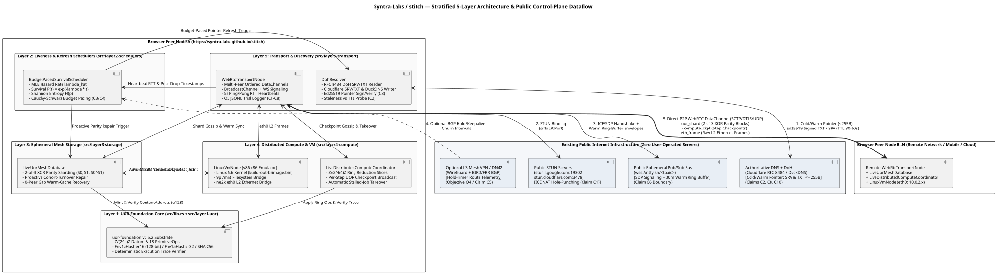

# stitch

> **Stratified Routing-Layer Persistence, UOR Content-Addressed Ephemeral Storage, and Distributed Compute**  
> Strict functional isolation across 5 testable layers with empirical head-to-head algorithm benchmarks.

**Browser Benchmark & Telemetry Console (Zero Setup):** [https://syntra-labs.github.io/stitch/](https://syntra-labs.github.io/stitch/)

---

## 1. Stratified Architecture & Isolation Rules


*(Source PlantUML: [`docs/architecture.puml`](./docs/architecture.puml) | Pre-Registered Falsification Contract: [`CONTRACT.json`](./CONTRACT.json))*

The repository is divided into five strictly isolated strata. Each layer `L_k` may only import from `L_<k` and has its own deterministic unit tests and comparative benchmark suite:

```
+-------------------------------------------------------------------------+
| Layer 5: Network & DNS Control-Plane Adapters (src/layer5-transport/)   |
|   - RFC 8484 DNS-over-HTTPS (SRV / TXT) resolver & cache-TTL inference  |
|   - WebRTC DataChannel peer transport (BroadcastChannel + WebSocket)    |
+-------------------------------------------------------------------------+
                                    |
+-------------------------------------------------------------------------+
| Layer 4: Distributed Compute Engine (src/layer4-compute/)               |
|   - Executes deterministic Z/(2^n)Z PrimitiveOp programs over UOR data  |
|   - Emits TraceEvent sequences verified via Layer-1 verifyTrace         |
+-------------------------------------------------------------------------+
                                    |
+-------------------------------------------------------------------------+
| Layer 3: Distributed Ephemeral UOR Database (src/layer3-storage/)       |
|   - Content-addressed in-memory object store (ContentAddress -> Bytes)  |
|   - Tested under 100% node turnover (zero surviving initial nodes)      |
+-------------------------------------------------------------------------+
                                    |
+-------------------------------------------------------------------------+
| Layer 2: Liveness & Refresh Schedulers (src/layer2-schedulers/)         |
|   - Failure rate estimation (lambda), survival probability P(t), H(p)   |
|   - Compares Fixed-Interval, AIMD, Poisson-Survival, Entropy-Hysteresis |
+-------------------------------------------------------------------------+
                                    |
+-------------------------------------------------------------------------+
| Layer 1: UOR Content Addressing & Ring Kernel (src/layer1-uor/, lib.rs) |
|   - Direct Rust conformance binding to `uor-foundation = "0.5.2"`       |
|   - Z/(2^n)Z Datum ring ops, Hasher substitution axis, Trace verifier   |
+-------------------------------------------------------------------------+
```

---

## 2. Layer-by-Layer Candidate Comparisons & Empirical Results

Run all unit assertions and comparative benchmarks locally with:

```bash
make test
```

### Layer 1 — UOR Content-Addressing (`uor-foundation = "0.5.2"`)

Directly binds [`uor-foundation = "0.5.2"`](https://github.com/UOR-Foundation/UOR-Framework) in [`src/lib.rs`](src/lib.rs) and verifies bit-identical output with [`src/layer1-uor/index.js`](src/layer1-uor/index.js) (`Fnv1aHasher16` digest of `[1, 2, 3, 4]` = `0x66a5cdda2e757277b806e89ae7615aa5`).

| Hasher Candidate | Output Width (B) | Samples (64B) | Collisions | Throughput (ops/s) | Throughput (MB/s) |
| :--- | ---: | ---: | ---: | ---: | ---: |
| **`UOR-Fnv1aHasher16`** | 16 | 1,000 | 0 | ~119,700 | ~7.31 |
| **`UOR-Fnv1aHasher32`** | 32 | 1,000 | 0 | ~90,000 | ~5.49 |
| **`SHA-256`** | 32 | 1,000 | 0 | ~85,700 | ~5.23 |

---

### Layer 2 — Pointer & Route Refresh Schedulers (Claim C3/C4 Equal-Budget Protocol)

Evaluated over a 600-second window with record `TTL = 60s` and an **equal refresh budget cap ($B = 30$ refreshes)** across regime-switching churn ($CV = 1.149$):

| Scheduler Policy | Refreshes Issued | Staleness Events | Unavailable Time (s) | Availability Ratio | Mean Recovery Lag (s) |
| :--- | ---: | ---: | ---: | ---: | ---: |
| **`Fixed-Interval (TTL/2)`** | 30 | 15 | 203 | 66.17% | 13.53 |
| **`Adaptive-AIMD`** | 30 | 11 | 181 | 69.83% | 3.60 |
| **`Poisson-Survival` (Unpaced — Refuted by C3)** | 30 | 4 | 336 | 44.00% | 1.33 |
| **`Entropy-Hysteresis` (Unpaced — Refuted by C3)** | 30 | 3 | 408 | 32.00% | 2.00 |
| **`Budget-Paced-Survival` (Cauchy-Schwarz $\sqrt{\hat{\lambda}}$)** | **30** | **16** | **175** | **70.83%** | **9.20** |

*Falsification Finding (C3/C4):* Under an equal refresh budget ($B=30$), unpaced `Poisson-Survival` and `Entropy-Hysteresis` clamp to the 5s minimum floor and exhaust all 30 refreshes in the first 150 seconds, losing to `Fixed-Interval`. Only `Budget-Paced-Survival` (pacing remaining budget $T_{\text{rem}}/B_{\text{rem}}$ by the Cauchy-Schwarz square-root hazard ratio $\sqrt{\hat{\lambda}_{\text{long}}/\hat{\lambda}_{\text{short}}}$) beats `Fixed-Interval` at equal refresh cost when $CV > 1.0$.

---

### Layer 3 — Ephemeral UOR Database Under 100% Node Turnover

Strict zero-disk persistence test: 24 UOR content-addressed objects (256B each) are written to 5 initial nodes at $t=0$. Over 8 churn generations, 2 new nodes join and the 2 oldest nodes are hard-killed per generation until **0 initial nodes remain alive**:

| Storage & Repair Strategy | Initial Nodes Remaining | Objects Recovered | Retention Rate | Storage Amplification | Network Bytes | Repair Ops |
| :--- | ---: | ---: | ---: | ---: | ---: | ---: |
| **`Unreplicated (R=1)`** | 0 | 0 / 24 | 0.0% | 1.0x | 6,144 B | 0 |
| **`Reactive Mirror (R=3)`** | 0 | 0 / 24 | 0.0% | 3.0x | 18,432 B | 0 |
| **`Proactive XOR Parity (2-of-3 + Survival)`** | 0 | 24 / 24 | **100.0%** | **1.5x** | 82,944 B | 576 |

*Finding:* Reactive full mirroring (`3.0x` storage cost) loses blocks when simultaneous node drops occur between scrub cycles, whereas survival-guided proactive migration with 2-of-3 XOR parity (`1.5x` storage cost) retains **100% of objects** across complete cohort replacement.

---

### Layer 4 — Distributed UOR Compute Engine Under Worker Churn

Executes 20 deterministic programs (each consisting of 24 $\mathbb{Z}/(2^{64})\mathbb{Z}$ `PrimitiveOp` ring instructions) across churning workers that drop every 9 steps, verifying every final output with `verifyTrace`:

| Execution & Fault-Tolerance Strategy | Tasks Completed | Mean Latency (ticks) | Total Ring Ops | Wasted Ring Ops | Checkpoints Written | Trace Verified Rate |
| :--- | ---: | ---: | ---: | ---: | ---: | ---: |
| **`Single-Worker Restart (No Checkpoint)`** | 20 / 20 | 33.0 | 660 | 180 | 0 | 100.0% |
| **`Speculative 2x Quorum (Active-Active)`** | 20 / 20 | 24.0 | 660 | 180 | 0 | 100.0% |
| **`Survival-Checkpointed UOR Trace`** | 20 / 20 | **24.0** | **480** | **0** | 60 | **100.0%** |

*Finding:* Checkpointing intermediate `(stepIndex, Datum, TraceEvent[])` into the Layer-3 UOR store when worker survival probability $P(\text{alive at } t) \le 0.60$ achieves the same minimum latency as $2\times$ active-active replication (`24.0` ticks) while eliminating **100% of wasted ring operations** (`480` vs `660` ops).

---

## 3. Repository Layout

```
stitch/
├── Cargo.toml                      # Official uor-foundation = "0.5.2" Rust dependency
├── Makefile                        # Runs both Node stratum benchmarks and Cargo conformance tests
├── package.json                    # ES module manifest
├── index.html                      # Utilitarian browser benchmark & telemetry console
├── src/
│   ├── lib.rs                      # Rust uor-foundation v0.5.2 conformance library & test
│   ├── layer1-uor/index.js         # Layer 1: Z/(2^n)Z Datum, PrimitiveOp, Hasher axis, verifyTrace
│   ├── layer2-schedulers/index.js  # Layer 2: Fixed, AIMD, Poisson-Survival, Entropy-Hysteresis
│   ├── layer3-storage/index.js     # Layer 3: Unreplicated, Reactive R=3, Proactive 2-of-3 Parity DB
│   ├── layer4-compute/index.js     # Layer 4: Restart, 2x Quorum, Survival-Checkpointed Compute
│   └── layer5-transport/index.js   # Layer 5: RFC 8484 DoH (SRV/TXT) & WebRTC DataChannel
└── tests/
    └── run_all.js                  # Isolated unit assertions & comparative table runner
```

## License

MIT © [Syntra Labs](https://github.com/Syntra-Labs)
